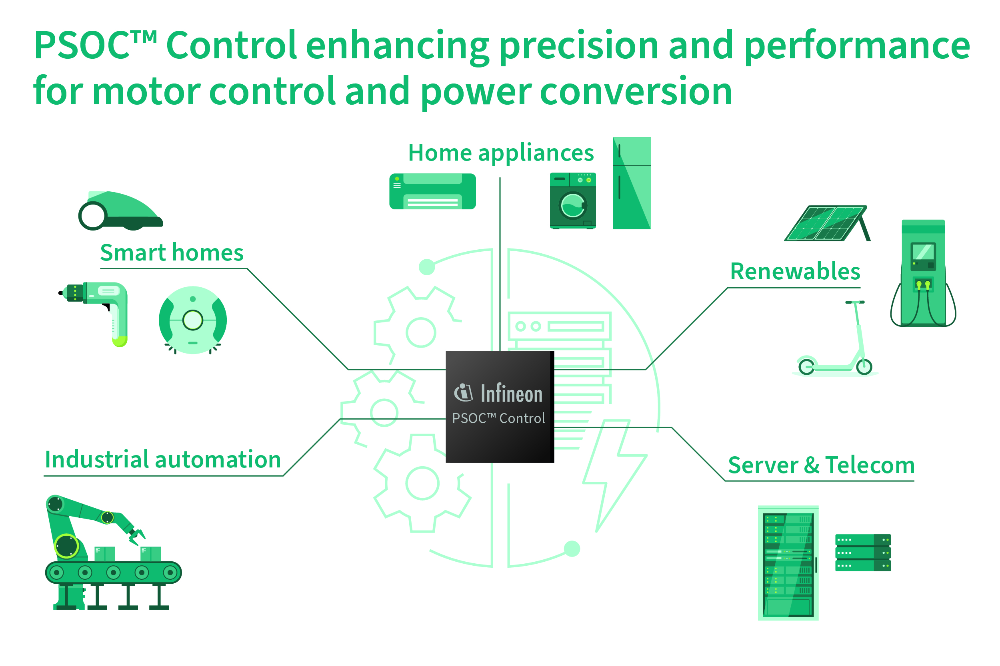

# PSOC™ Control C3 Training

This E2 training introduces the PSOC™ Control C3 M5/P5 platform through 12 sessions covering its applications, architecture, peripherals, power, security, safety, and motor control.

## Get started

The presentations and selected lab manuals are available in the [main PSOC™ Control C3 training repository](https://github.com/Infineon/mtb-training-psoc-control-c3m5-c3p5). The course assumes basic ModusToolbox™ knowledge and uses the KIT_PSC3M5_EVK.

## Sessions

1. Platform introduction
2. Top applications and use cases
3. Core architecture and memory: CPU, interrupts, and clocks
4. I/O and serial connectivity
5. Timers and analog subsystems
6. CORDIC math accelerator
7. Power management strategies
8. Middlewares and EEPROM setup
9. Security, boot, and IPC
10. Functional Safety Test Library (STL)
11. IDE workflows for Keil, IAR, and ModusToolbox™
12. Motor control fundamentals

## Training index

Browse the [ModusToolbox™ training page](https://github.com/Infineon/training-modustoolbox) for PSOC™ and other device training.